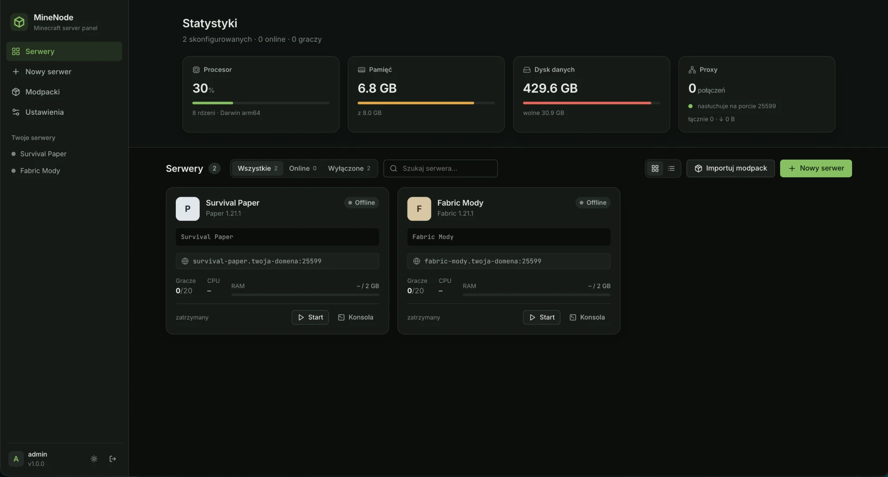
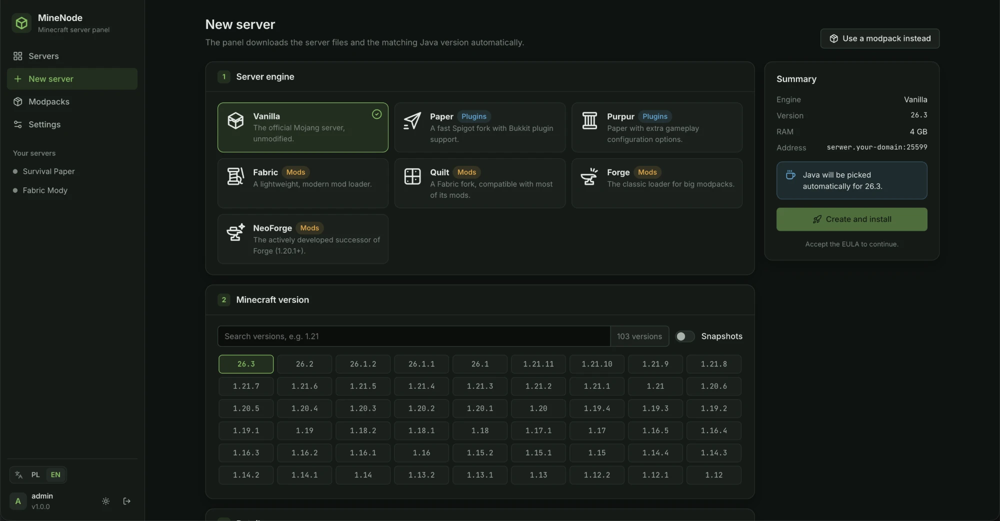
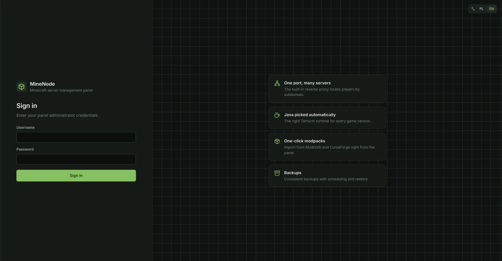

# MineNode



A self-hosted panel for running Minecraft servers. It ships as a single Docker container and gives you:

- **7 engines**: Vanilla, Paper, Purpur, Fabric, Quilt, Forge and NeoForge. Versions and builds come live from the official APIs.
- **Custom JAR**: run any other server software (e.g. a hybrid or your own build). MineNode downloads nothing: upload the `.jar` in the Files tab and it is found on start, whatever its name (pick one in *Java & startup* when there are several). The Minecraft version you choose only selects the Java runtime.
- **Automatic Java**: MineNode reads the required Java version from Mojang's metadata and downloads Eclipse Temurin (8/11/17/21/25) through the Adoptium API.
- **A built-in Minecraft reverse proxy**: every server runs behind one port (`25565`), and players land on the right one by subdomain (`survival.mc.example.com`, `creative.mc.example.com`, …).
- **Key settings in the creation wizard**: max players, premium-only (online-mode), login for non-premium players, whitelist, Bedrock (checked against Geyser before the server is created), game mode, difficulty, PvP, hardcore, flight, view distance, start on join and auto-stop when empty.
- **Custom world generation at creation**: pick the world type (flat, large biomes, amplified or a datapack/mod world preset), a seed, and add world generator datapacks, plugins (Terra, Iris…) or mods – uploaded or picked from Modrinth's world generation category, with required dependencies downloaded automatically. MineNode recognises each file, checks it fits the engine and puts it in place before the first start (`world/datapacks/`, `plugins/` + `bukkit.yml` generator, `mods/`), so the world is generated with it from the start.
- **Modpack import** from Modrinth (`.mrpack`) and CurseForge (manifest or official server pack), including uploaded files.
- **One-click mods and plugins**: search Modrinth and CurseForge filtered to the server's engine and Minecraft version. Required dependencies are installed automatically.
- **Compatibility checks**: every file in `mods/` or `plugins/` is identified on Modrinth by SHA-1 and checked against the game version and loader. MineNode suggests updates (including "Update all") and prints warnings about incompatible files in the console on every start.
- **Datapacks**: upload a ZIP or install from Modrinth (the version that matches the server). MineNode checks that the file is a datapack (not a resource pack, plugin or mod), fixes packs wrapped in a folder, and puts it in `<world>/datapacks/`. Packs can be disabled without deleting them (they are moved out of the world) and take effect after a restart.
- **Resource pack hosting on the Minecraft port**: upload a ZIP or get a pack from Modrinth/CurseForge. MineNode validates `pack.mcmeta` (and fixes packs wrapped in a folder), serves the pack over port `25565` from its own subdomain (`packs.mc.example.com`), and writes the URL and SHA-1 into `server.properties` with one click. No extra port is needed.
- **Simple Voice Chat for every server through one UDP port**: install SVC with one click. A shared UDP proxy (`24454`) routes each player to the right server by the player UUID that SVC puts in every packet.
- **Bedrock Edition through one shared Geyser port**: enable Bedrock per server and share a single Bedrock port (`19132/tcp` + `19132/udp`). A bundled Geyser extension routes players by the address they entered to the same server as Java Edition. The Java proxy also receives the player's real Bedrock address through the PROXY protocol.
- **Player authentication for offline servers**: a hidden PicoLimbo Rust lobby with `/register` and `/login`, enabled per server. The **Autoryzacja** tab manages active sessions and passwords and shows informational client fingerprints without ever exposing passwords.
- **Public server page with an optional live map**: every server has a public stats page at `/<subdomain>/stats` (no login): who is online, who played recently, uptime, the server as it looks in the multiplayer list, how to join and the last 50 chat messages (read from the server log, so they survive a panel restart; chat text is never treated as a server event). If the owner allows it, visitors can start a stopped server with one button. **Player statistics**: clicking a player on the public page shows their world statistics (play time, deaths, kills, distance traveled, blocks mined, items crafted, and per-item breakdowns) read from the `<uuid>.json` files in the world's `stats/` folder (Minecraft 1.13+). The panel merges stats from every world (Multiverse, Nether, End) and persists player names/UUIDs so history survives log rotation and cache expiry. Turn on a live world map for that server and it appears on the same page. Pick **squaremap** (light 2D), **Dynmap** (flat, optionally isometric) or **BlueMap** (3D, optionally flat only – the lighter default). MineNode installs, updates and configures the chosen map; other maps it manages are disabled but kept on disk. squaremap's web files are served by the panel; Dynmap and BlueMap run their web servers on `127.0.0.1` and the panel proxies them under `/map/<server id>/` (GET only, web chat off), so no extra port is exposed. An option hides player positions. All three maps draw new and changed chunks by themselves; terrain from before the map was enabled is drawn by a full render that runs only when you press **Render map** (BlueMap scans the world on its own). Enabling BlueMap accepts the Minecraft EULA for BlueMap's download of client resources from Mojang.

  | Map | Paper / Purpur | Fabric / Quilt | Forge | NeoForge |
  | --- | --- | --- | --- | --- |
  | squaremap | 1.19.3 – 26.3 | 1.19.3 – 26.3 | 1.19.3 – 1.20.1 | 1.20.2 – 26.3 |
  | Dynmap | 1.13.2 – 26.3 (Dynmap CE from GitHub; Modrinth up to 1.21.4) | up to 1.21.11 (Modrinth), 26.1 (CE) | up to 1.21.11, 26.1 (CE) | – |
  | BlueMap | 1.13 – 26.3 | 1.15.2 – 26.3 | 1.14.4 – 26.3 | 1.20.2 – 26.3 |

- **Distant terrain (LOD) for Distant Horizons and Voxy**: in *Services*, turn on server-side LODs so players with the client mod see terrain hundreds of chunks away without exploring. Distant Horizons uses the DH mod on Fabric/Quilt/Forge/NeoForge and the *Distant Horizons Support* plugin on Paper/Purpur; Voxy uses *LOD Server Support* from its original author (Fabric/Quilt/NeoForge mod, Paper/Purpur plugin; Minecraft 1.21.1 and newer, no Forge). *Voxy Server Side* is the same mod republished under another name and speaks the same protocol, so players can use either; a Voxy Server Side jar installed by an earlier MineNode version is replaced and its settings file carried over. MineNode writes light settings: a 64–512 chunk radius (DH needs at least 256), two worker threads, a few requests per player, capped bandwidth and – unless you enable *Generate missing terrain* – LODs only from chunks that already exist (pre-generate with Chunky instead). The public stats page tells players which LOD mods the server supports, with Modrinth links.
- **Add-ons tab**: everything you add on top of the server in one place, split into sub-tabs – *Plugins/Mods*, *Resource packs*, *Datapacks* and *Services*. *Services* holds optional per-server features: player login, Simple Voice Chat, Bedrock (Geyser), the public page with the live map, distant terrain (LOD), and **Chunky world pre-generation**. The Java runtime, memory and JVM flags live under **Settings → Java & startup**. MineNode installs the Chunky plugin or mod that matches the engine and Minecraft version (with Fabric API where needed). Set the world, shape, pattern, center and radius, then start, pause, resume or cancel with live progress (percent, rate, ETA). Generation can run only while nobody plays: it pauses when someone joins and resumes a minute after the server is empty. *Multi-core generation* raises Paper/Purpur's `chunk-system.worker-threads` to every core but one, or installs C2ME on Fabric/Quilt (not available on Forge/NeoForge).
- **Live console** (WebSocket) with ANSI colours, command history, filtering and WARN/ERROR highlighting.
- **Monitoring**: process CPU and RAM (15-minute charts), online players, host resources and the container memory limit.
- **Lifecycle control**: start, graceful stop, restart and kill. Also autostart, crash auto-restart with backoff, start on join, a daily restart, and **auto-stop when nobody is online**.
- **Point-and-click configuration**: a `server.properties` editor, RAM and JVM flags (Aikar / ZGC) with a live startup command preview.
- **WYSIWYG MOTD editor**: bold, italic, underline, strikethrough, `§k`, the 16 Minecraft colours, special characters and undo/redo. It includes a server-list preview (with animated `§k`) and a raw `§` code mode.
- **Custom offline/starting appearance**: set the MOTD, version label and kick messages for stopped, starting and waking servers, with `{name}`, `{motd}`, `{address}`, `{mc_version}` and `{join_hint}` placeholders.
- **Players**: a whitelist that lists players who tried to join without being on it (add them in one click), OP with a permission level, kick, ban and pardon.
- **File manager**: browse, edit text files, drag-and-drop upload, unzip, and **download every server file as one ZIP** (streamed, no temporary files).
- **Backups anywhere**: consistent backups (`save-off` / `save-all flush`) with scheduling and per-destination retention. You can store them on the panel disk, a **mounted folder** (NAS share, second disk), **S3-compatible storage** (AWS, Backblaze B2, Cloudflare R2, Wasabi, MinIO) or **WebDAV** (Nextcloud, ownCloud, Synology), and on several at once. Download and restore work from any of them.
- **English and Polish UI**: switch the language in the sidebar or on the login screen.



---

## Quick start

```bash
docker compose up -d
```

Open `http://<host>:8080`. On first visit a setup wizard asks you to create the administrator account, unless you set `MINENODE_ADMIN_USER` / `MINENODE_ADMIN_PASSWORD`.



| Port | Purpose |
|------|---------|
| `8080/tcp` | Web panel, API and WebSocket |
| `25565/tcp` | Minecraft: one shared port for every server (proxy), also serves resource packs |
| `24454/udp` | Simple Voice Chat: one shared port for every server |
| `19132/tcp` + `19132/udp` | Bedrock Edition: one shared Geyser port (optional, listens only when Bedrock is enabled) |

All data (servers, worlds, Java runtimes, backups, panel config) lives in the `/data` volume.

### Deploying with Dockge / Portainer

The repository builds a single image, so you can paste the compose file into Dockge. To build straight from GitHub without uploading any files, use a remote build context:

```yaml
services:
  minenode:
    build:
      context: https://github.com/BernardGFB1/Minenode.git#main
    image: minenode:latest
    container_name: minenode
    restart: unless-stopped
    ports:
      - "8080:8080"           # Web panel, API and WebSocket (HTTP)
      - "25565:25565"         # Minecraft Java: one shared port for every server (proxy by subdomain) + resource pack downloads
      - "24454:24454/udp"     # Simple Voice Chat: one shared UDP port for every server
      - "19132:19132/tcp"     # Bedrock Edition (Geyser): NetherNet signaling – players find the server here
      - "19132:19132/udp"     # Bedrock Edition (Geyser): gameplay traffic
    volumes:
      - ./data:/data
    environment:
      TZ: Europe/Warsaw
    stop_grace_period: 2m
```

### DNS and subdomains

1. In **Panel settings**, set the *base domain*, e.g. `mc.example.com`.
2. Add a wildcard DNS record: `*.mc.example.com  A  <server IP>` (optionally also `mc.example.com`).
3. Each server gets its own subdomain (e.g. `survival`), so players join `survival.mc.example.com`.
4. Optional: add more *main domains* (**Add domain**), e.g. `play.second-domain.net`, each with its own wildcard record. Every server then answers on all of them (`survival.mc.example.com`, `survival.play.second-domain.net`, …) for Java and Bedrock. The first domain is the default; in a server's settings (and when creating it) you pick which domain its address shows on the server card, the public page and in Simple Voice Chat. Removing a domain moves servers that showed it back to the default one. When domains overlap (`example.com` and `mc.example.com`), the longer one decides.

Connections by IP or to an unknown name go to the *default server* (set in the panel). MineNode never picks one by itself – not for the first server, nor when the default server is deleted – so until you choose one, such connections are rejected. You can also attach any full domain, such as `play.myserver.net`, as an *alias* in the server settings. Bedrock players use the same hostnames on port `19132` (see [Bedrock Edition](#bedrock-edition-geyser)). Like on Java, unknown Bedrock addresses go to the default server (if it has Bedrock enabled), otherwise they are rejected.

### Resource packs

Players download packs straight from the Minecraft port: `http://packs.<base domain>:25565/rp/<server>/<token>/<id>.zip`. The proxy recognises plain HTTP requests on the game port, so no extra port or web server is required. The subdomain (`packs` by default) is configurable in **Panel settings**. If you prefer to serve packs through your own HTTPS reverse proxy, set the *custom resource pack host* there.

### Simple Voice Chat

Open **Server → Settings → Voice chat** and click *Install & enable*. MineNode:

- installs Simple Voice Chat from Modrinth (mod or plugin, matching the engine);
- gives the server a private internal voice port and binds it to `127.0.0.1`;
- sets `voice_host` to `<server address>:24454`, so clients connect to the shared proxy.

The proxy reads the player UUID at the start of every SVC packet and forwards it to the server that player is on. Open UDP `24454` on your firewall.

### Bedrock Edition (Geyser)

MineNode can expose selected servers to Minecraft Bedrock Edition through Geyser Standalone, using one shared Bedrock port (`19132` by default). Geyser runs with `advanced.bedrock.validate-bedrock-login: false`. Hostname routing, whitelist, *start on join*, player IPs and voice chat keep working exactly as for Java players: Geyser connects to the Java proxy as a normal Java client, forwards the address the player entered, and prefixes the connection with a PROXY v2 header carrying the real Bedrock address. The proxy accepts that header only from loopback, so a public client cannot spoof its IP.

MineNode automatically checks the Java version supported by the current Geyser build and keeps Geyser updated from the official Downloads API. Older Paper/Purpur servers receive a managed ViaVersion plugin; Fabric servers receive ViaFabric and Fabric API. The gateway is restarted by itself after a Geyser update, while Minecraft servers are not restarted. Vanilla, Forge, NeoForge and Quilt servers are blocked when they need a translator that their loader cannot provide.

**Geyser build and console** (Panel settings → *Geyser logs*): run the stable release (default) or a *test build* from a Geyser pull request, e.g. PR #6873 with NetherNet fixes and diagnostics for slow joins and delays ([GeyserMC/Geyser#6854](https://github.com/GeyserMC/Geyser/issues/6854)). Switching downloads the build from `download.geysermc.org` (project `geyserpreview`, SHA-256 checked) and restarts only the gateway; switching back to stable is one click. Commands typed under the log go to Geyser's console – *NetherNet stats* prepares `geyser nethernet stats <player>` (available in the test build). The same card can turn off Geyser's integrated resource pack (`gameplay.enable-integrated-pack`) to diagnose slow joins on weaker devices.

### Player authentication for offline servers

MineNode runs one hidden, lightweight PicoLimbo Rust authentication lobby with `/register` and `/login`. PicoLimbo natively supports clients from 1.7.2 through current supported releases, so the lobby does not need ViaVersion, ViaBackwards or ViaRewind and does not require a Java heap. Players connecting to an offline-mode server without a valid session are sent to the lobby. After successful authentication the lobby disconnects them with a reconnect message; the next connection is routed to the original server. The target server does not need to be Paper and does not receive lobby players in its slot count.

Authentication is managed in the **Autoryzacja** tab (above Settings). It explains how the lobby works and lists active sessions with player names and public IPs (also the real Bedrock IP), plus all registered players. Administrators can end a session, change a player's password or remove it so the player can register again. Existing passwords and hashes are never displayed or returned by the API.

The proxy passively inspects offline-mode authentication sessions and stores an informational fingerprint from the first 15 seconds of a connection (login and configuration, before normal gameplay): Client Information (locale, view distance, chat and skin settings, main hand), the client brand and announced Plugin Message channel names with sizes and SHA-256 digests. Gameplay packets, chat, movement and inventory data are not stored. The hidden lobby is a different server, so its capture is informational only; the first capture from the actual game server binds the session. Only stable values (protocol, brand and channel names) are used in the session hash, so changing render distance, chat mode or skin visibility does not require a new login. A changed stable fingerprint invalidates the session and requires login again. Fingerprints are retained without automatic expiry until the account is removed.

Sessions last 30 minutes from the last entry or exit and are bound to both player name and IP address. A login from another IP requires authentication again. A wrong password ends the lobby visit, and the proxy limits failed visits (10 per IP and 20 per name every 15 minutes; the name limit never locks out the address the account last logged in from). While someone is logging in under a name, nobody else can enter the lobby under that name from another address, and a lobby visit lasts at most 3 minutes. Game servers listen on `127.0.0.1` only, so the login check cannot be skipped by connecting to a server's internal port. The lobby is managed by MineNode and starts automatically; its files live under `auth-lobby/`, while credentials, sessions and fingerprints are stored under `auth/`. The PicoLimbo authentication module changes passwords only through the panel API.

#### Where PicoLimbo comes from and how it updates

The lobby runs [PicoLimbo](https://github.com/Quozul/PicoLimbo) by Quozul, **built on your server from the author's own source code**. MineNode does not publish PicoLimbo binaries and keeps no copy of its source. MineNode's `/login` and `/register` module is a small patch (`backend/app/assets/picolimbo/minenode-auth.patch`) – our own code, applied on top of the author's release.

On first start the panel:

1. asks the author's repository for its newest release (GitHub API, or the release page when the API rate limit is reached),
2. installs the official Rust toolchain with `rustup` into `auth-lobby/rust/` (PicoLimbo's `rust-toolchain.toml` decides the version),
3. downloads that release's source archive from `github.com/Quozul/PicoLimbo`, applies the patch and runs `cargo build --release` at a low CPU priority on half of the cores,
4. installs the result into `auth-lobby/bin/` and deletes the sources and build files (the toolchain and crate cache stay for the next build, roughly 1 GB).

The first build takes a few minutes; the panel and the game servers start normally in the meantime and the **Autoryzacja** tab shows the progress. Every 6 hours the panel checks for a new upstream release (or a changed login module) and rebuilds; the lobby keeps running the previous build until the new one is ready. A failed build is shown with the end of its log and retried after 6 hours or with *Check for a PicoLimbo update*. A binary downloaded by older MineNode versions from MineNode's own releases is replaced by a local build automatically. The Docker image contains the C compiler (`gcc`) and `patch` that the build needs.

### Portable server packages

In **Server → Settings**, use **Export .minenodepack** to create a portable package containing the server configuration, world, installed engine, plugins/mods, resource packs, `.minenode` metadata and per-server player data. The server must be stopped before export so the world is consistent. On the dashboard, **Import .minenodepack** creates a new server with a new ID and automatically allocated internal/voice ports; the original server is not overwritten. Packages contain a versioned manifest and can be imported by later MineNode releases as long as the package schema is supported. Hostnames and aliases are checked for conflicts during import.

1. Open **Server → Settings → Bedrock Edition (Geyser)** and enable *Share via Bedrock* for the servers you want. Geyser is enabled independently of the Java proxy and does not affect it.
2. Open **TCP and UDP** port `19132` on your firewall and router. NetherNet uses TCP signalling and UDP gameplay on the same port.
3. Players add a server in Bedrock with the same address Java players use, e.g. `survival.mc.example.com`, port `19132`. The address must resolve on the player's device; Bedrock has no SRV records.
4. Set **Public address** in the panel settings (or *Address advertised to Bedrock players*). After finding the server, Bedrock opens the game connection to the address Geyser advertises. Without one, Geyser guesses the public address through STUN, and behind Docker or a home router NAT usually picks a random port that is not forwarded: players see the server but cannot join. If no public address is set, MineNode advertises a server hostname under the base domain when it resolves.

Port `19132` is shared by every server, so there is no per-server Bedrock port to open. Disabled or incompatible servers keep their hostnames reserved: connecting to their address is rejected instead of reaching that server or landing on another one. Enabling the first server downloads Geyser and Java 21 automatically; the gateway starts when the first server enables Bedrock and stops when none do.

**Authentication:** Geyser has one global auth mode. If **any** enabled Bedrock server runs in online mode, MineNode sets `auth-type: online`, and every Bedrock player must have a Java Edition account linked to their Xbox account. When all enabled Bedrock servers are offline-mode, MineNode switches to `offline`, so Bedrock players do not need Java Edition. The mode is re-evaluated automatically, and only Geyser restarts when it changes — the Java proxy and servers never restart. Letting Bedrock players join an online-mode server without Java Edition requires Floodgate, which MineNode does not install yet.

For `auth-type: online`, Geyser asks Microsoft only once per saved Bedrock username. Set `MINENODE_BEDROCK_SAVED_LOGINS` to the Bedrock gamertag(s), separated by commas, for example `PlayerOne,PlayerTwo`, then recreate the container. Geyser stores refresh tokens in `/data/bedrock/saved-refresh-tokens.json`; it stores tokens, not passwords. Do not expose that file or include it in public backups.

### HTTPS for the panel

Put the panel behind an HTTP reverse proxy (Caddy, Traefik, nginx) with TLS and set `MINENODE_SECURE_COOKIES=true`. For example, with Caddy:

```
panel.example.com {
    reverse_proxy minenode:8080
}
```

Also set `MINENODE_TRUSTED_PROXIES` to the address of that proxy (for a proxy in another Docker container, its network range such as `172.16.0.0/12`). Only those addresses may tell MineNode the real client IP through `X-Forwarded-For`; anyone else could otherwise pick their own IP and get around the login attempt limit.

WebSockets work out of the box. Expose the Minecraft (`25565/tcp`), voice (`24454/udp`) and Bedrock (`19132/tcp` + `19132/udp`) ports directly.

### Backup destinations

Add destinations in **Panel settings → Backup destinations**, then pick them in each server's **Backups** tab (both for manual and scheduled backups). Every destination has a *Test connection* button that writes, reads and deletes a small file.

| Type | What to enter |
|------|---------------|
| Folder / NAS | A path **inside the container**. Mount it first, e.g. `- /mnt/nas/minecraft-backups:/backups/nas`, then use `/backups/nas` |
| S3 | Bucket, prefix, access/secret key; endpoint + region for non-AWS providers (presets included). Enable *path-style* for MinIO |
| WebDAV | Folder URL (e.g. `https://cloud.example.com/remote.php/dav/files/<user>/Backups`), username and password (use an app password in Nextcloud) |

Backups are stored as `<server-id>/<backup-id>.zip` plus a `.json` sidecar with metadata, so a destination can be browsed by hand. Large uploads to S3 use multipart transfers. Deleting a server removes only the copies on the panel disk, and backups in external destinations are kept.

### CurseForge

CurseForge needs your own free API key from [console.curseforge.com](https://console.curseforge.com/). Paste it into **Panel settings** or set `CURSEFORGE_API_KEY`. Modrinth works without a key.

Some authors block API downloads of their files. MineNode lists those files in the console so you can upload them to `mods/` with the file manager.

---

## Environment variables

| Variable | Default | Description |
|----------|---------|-------------|
| `MINENODE_PORT` | `8080` | Panel port |
| `MINENODE_PROXY_PORT` | `25565` | Public Minecraft port (proxy) |
| `MINENODE_VOICE_PORT` | `24454` | Public Simple Voice Chat UDP port |
| `MINENODE_BEDROCK_PORT` | `19132` | Public Bedrock port (Geyser, TCP + UDP) |
| `MINENODE_BEDROCK_SAVED_LOGINS` | – | Comma-separated Bedrock usernames whose Microsoft login token Geyser should save and refresh |
| `MINENODE_INTERNAL_PORT_START` | `25600` | First internal game port (assigned automatically) |
| `MINENODE_INTERNAL_VOICE_PORT_START` | `24500` | First internal voice port (assigned automatically) |
| `MINENODE_DATA` | `/data` | Data directory |
| `MINENODE_ADMIN_USER` / `MINENODE_ADMIN_PASSWORD` | – | Account created on first start (instead of the wizard) |
| `MINENODE_SECURE_COOKIES` | `false` | Send session cookies over HTTPS only |
| `MINENODE_PICOLIMBO_REPO` | `Quozul/PicoLimbo` | Repository of the PicoLimbo author whose newest release is compiled for the authentication lobby |
| `MINENODE_PICOLIMBO_BINARY` | – | Run this local PicoLimbo binary instead of compiling one (no automatic updates) |
| `GITHUB_TOKEN` | – | Optional token for the GitHub API (only needed behind a shared IP that hits GitHub's rate limit) |
| `MINENODE_TRUSTED_PROXIES` | `127.0.0.1` | Reverse proxies allowed to set `X-Forwarded-For` (comma-separated IPs or CIDR ranges, e.g. `172.16.0.0/12`). Used for the client IP in the login limit |
| `CURSEFORGE_API_KEY` | – | CurseForge API key |
| `PUID` / `PGID` | `1000` | User the panel and servers run as |
| `TZ` | `Europe/Warsaw` | Time zone (daily restarts, backups) |

---

## Architecture

```
                 ┌──────────────────────────── minenode container ───────────────────────────┐
 browser ───────▶│ :8080  FastAPI ── REST /api/* ── WebSocket /api/servers/{id}/ws            │
                 │          │           Vue 3 SPA (static files)                              │
                 │          ▼                                                                 │
                 │      Manager ── ServerInstance × N ── java -Xmx… -jar …  (:25600, :25601…)  │
                 │          │            ▲  stdin/stdout (console, commands, log parsing)      │
 Minecraft ─────▶│ :25565 MinecraftProxy ┘  handshake → hostname → internal port               │
                 │          └─ HTTP GET /rp/… → resource pack files                           │
 voice (UDP) ───▶│ :24454 VoiceProxy ── player UUID → server's internal SVC port (:24500…)    │
 Bedrock ───────▶│ :19132 Geyser + MineNodeRouter ── hostname ──▶ :25565 proxy                │
                 │   Java (Temurin, auto)   Providers (Mojang/Paper/Purpur/Fabric/…)          │
                 │   Backups (zip)          Modpacks & content (Modrinth / CurseForge)        │
                 └──────────────────────────────────── /data ─────────────────────────────────┘
```

**Backend** (`backend/app`, Python 3.12, FastAPI, asyncio):

| Module | Role |
|--------|------|
| `main.py` | App and lifecycle (graceful server shutdown on `docker stop`), CSRF, SPA serving |
| `api.py` | REST + WebSocket endpoints |
| `manager.py` | Server processes, console, metrics (psutil), log parsing (players, whitelist rejections), scheduler, idle shutdown |
| `proxy.py` | Minecraft-aware TCP proxy: parses Handshake/Login Start, routes by host, answers for offline servers, optional inbound PROXY protocol v2 (real Bedrock IP), serves resource packs over HTTP on the same port |
| `fingerprint.py` | Passive Client Information / Plugin Message sniffer and version-tolerant packet framing used by the session fingerprint |
| `auth_sessions.py` | Shared player account, session and fingerprint storage used by the proxy and the PicoLimbo lobby |
| `auth_lobby.py` | Hidden PicoLimbo authentication lobby lifecycle |
| `picolimbo.py` | Builds PicoLimbo from the author's source (with the MineNode login patch) on the server and keeps it up to date |
| `voice.py` | UDP proxy for Simple Voice Chat (routing by player UUID) and SVC config management |
| `bedrock.py` | Shared Geyser Bedrock gateway: downloads Geyser, generates `config.yml` and hostname routes, manages the process and global auth mode. `backend/bedrock_ext/` is the bundled MineNodeRouter extension that resolves each Bedrock hostname (compiled during the Docker build) |
| `providers.py` | Version discovery and engine installation (incl. Forge/NeoForge/Quilt installers) |
| `java.py` | Java selection and download from Adoptium |
| `modpacks.py` | Modrinth `.mrpack`, CurseForge manifests and server packs, file import |
| `content.py` | Mods & plugins: search, install with dependencies, inventory, compatibility checks, updates |
| `resourcepacks.py` | Resource pack library, hosting, `server.properties` activation |
| `datapacks.py` | Datapacks of the main world: list, upload/Modrinth install, enable/disable, delete |
| `backups.py` | Consistent ZIP backups across destinations, per-destination retention, restore with rollback on failure |
| `storage.py` | Backup storage backends: panel disk, mounted folder, S3 (boto3), WebDAV |
| `players.py` | whitelist/ops/bans JSON, UUIDs from Mojang or offline mode |
| `files.py` | Safe paths, streamed ZIP downloads |
| `auth.py` | scrypt passwords, HMAC-signed sessions (httpOnly, SameSite=Strict), login rate limiting |

**Frontend** (`frontend/`, Vue 3 + Vite, no UI framework): a custom design system with light and dark themes, Lucide icons, and Inter / JetBrains Mono / Pixelify Sans fonts bundled locally (no external CDNs).

**Translations**: Polish source strings are the keys (`$t('…')`) and `frontend/src/locales/en.js` holds the English dictionary. Messages coming from the backend are matched against templates in the same file. A missing translation falls back to Polish, so new features never break the UI.

### `/data` layout

```
/data
├── servers/<id>/          # server files (world, mods/, plugins/, server.properties…)
│   └── .minenode/         # panel metadata: content.json (mods/plugins), resourcepacks/
├── backups/<id>/*.zip     # backups + .json metadata
├── java/temurin-<N>/      # downloaded Java runtimes
├── panel/                 # servers.json, settings.json, users.json, secret.key, players/
├── bedrock/               # Geyser jar, config.yml, logs, extensions/MineNodeRouter
├── auth-lobby/            # hidden PicoLimbo authentication lobby and config
├── auth/                  # player credentials, sessions and informational client fingerprints
└── tmp/                   # temporary install files
```

---

## Local development

```bash
# backend
cd backend && python -m venv .venv && . .venv/bin/activate && pip install -r requirements.txt
MINENODE_DATA=./data MINENODE_PROXY_PORT=25599 MINENODE_VOICE_PORT=24499 MINENODE_BEDROCK_PORT=19199 uvicorn app.main:app --reload --port 8080

# frontend (proxies /api to :8080, hot reload)
cd frontend && npm install && npm run dev
```

API docs (OpenAPI): `http://localhost:8080/api/docs`.

---

## Security

- The panel runs servers as an unprivileged user (`PUID`/`PGID`), never as root.
- State-changing requests require an `X-Requested-With` header (CSRF protection), and the WebSocket checks `Origin`.
- Logins are limited to 8 attempts per IP and 20 per account every 5 minutes, counted before the password is checked. Unknown usernames take as long as known ones, and an open console closes when its session is no longer valid (password change, deleted account).
- Logging out revokes that session cookie on the server, and cookies are tied to the account they were issued for (a deleted and re-created user does not inherit old sessions).
- Game servers listen on `127.0.0.1` only. Players always come in through the MineNode proxy, which also refuses logins whose player name it cannot read instead of passing them through.
- Paths in the file manager, modpack archives and backups are checked against directory traversal (zip-slip).
- Resource pack URLs contain an unguessable token, and the voice ports of individual servers are bound to `127.0.0.1`.
- Servers start with `-Dlog4j2.formatMsgNoLookups=true` (Log4Shell protection for older versions).
- If you set `MINENODE_ADMIN_PASSWORD` in a public compose file, change the password in the panel after the first login.

## Limitations

- Bedrock Edition is supported through Geyser on one shared port (`19132/tcp` + `19132/udp`), enabled per server. Geyser's global auth mode means that when any enabled server is online-mode, Bedrock players need a linked Java Edition account; Floodgate is not included.
- The pre-1.7 legacy server list ping is not routed.
- Behind the proxy, servers see players as `127.0.0.1`. To pass real IPs, enable *PROXY protocol* in the server settings and on the server side (e.g. Paper: `proxies.proxy-protocol: true`).
