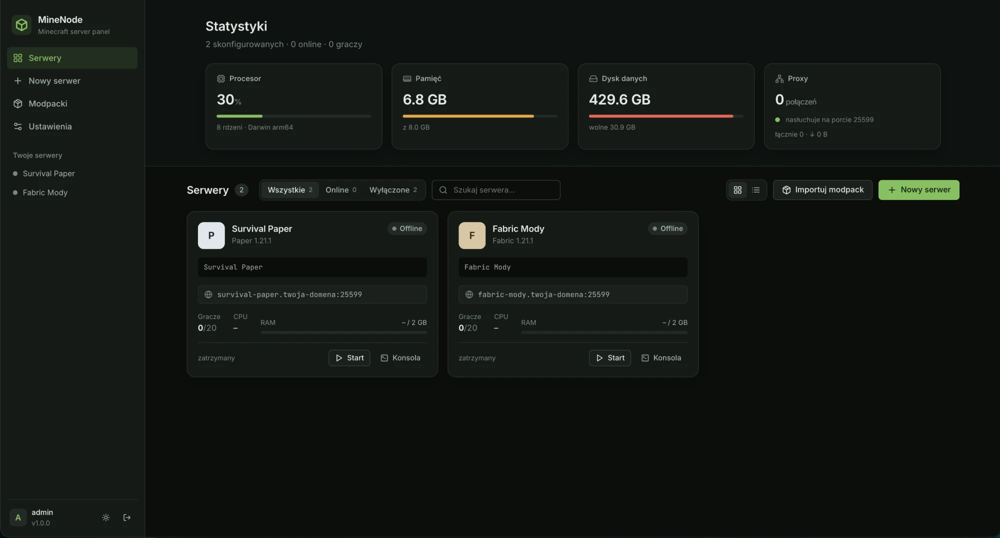

# MineNode



Samodzielnie hostowany panel do zarządzania serwerami Minecraft Java. Działa w jednym kontenerze Dockera i zawiera:

- **7 silników**: Vanilla, Paper, Purpur, Fabric, Quilt, Forge, NeoForge. Wersje i buildy są pobierane na żywo z oficjalnych API.
- **Automatyczną Javę**: panel sam odczytuje z metadanych Mojang, jakiej Javy wymaga dana wersja gry, i pobiera Eclipse Temurin (8/11/17/21/25) przez Adoptium API.
- **Wbudowany reverse proxy Minecraft**: wszystkie serwery działają na jednym porcie `25565`, a gracz trafia na właściwy serwer według subdomeny (`survival.mc.example.com`, `kreatywny.mc.example.com`, …).
- **Import modpacków** z Modrinth (`.mrpack`) i CurseForge (manifest albo oficjalna paczka serwerowa), także z pliku wgranego przez przeglądarkę.
- **Konsolę na żywo** (WebSocket) z kolorami ANSI, historią komend, filtrowaniem i wyróżnianiem WARN/ERROR.
- **Monitoring**: CPU i RAM procesu (wykresy z 15 minut), gracze online, zasoby hosta i limit pamięci kontenera.
- **Cykl życia**: start, stop (łagodny, przez `stop`), restart, kill, autostart, restart po awarii z ograniczeniem prób, start przy próbie dołączenia (*start on join*) i codzienny restart.
- **Wyklikaną konfigurację**: edytor `server.properties` z podglądem MOTD i kodów `§`, ustawienia RAM i flag JVM (Aikar / ZGC) z podglądem komendy startowej.
- **Graczy**: whitelistę z listą graczy, którzy próbowali wejść i nie są na liście (dodajesz ich jednym kliknięciem), nadawanie OP z poziomem, kick, ban i pardon.
- **Menedżer plików**: przeglądanie, edycja tekstu, upload metodą drag&drop, rozpakowywanie ZIP oraz **pobranie wszystkich plików serwera jednym ZIP-em** (strumieniowo, bez plików tymczasowych).
- **Kopie zapasowe**: spójne (`save-off` / `save-all flush`), z harmonogramem i retencją, do pobrania i przywrócenia.
- **Mody i pluginy jednym kliknięciem**: wyszukiwarka Modrinth i CurseForge filtrowana pod silnik i wersję serwera. Panel sam doinstalowuje wymagane zależności.
- **Weryfikację zgodności**: każdy plik w `mods/` lub `plugins/` jest identyfikowany po SHA-1 w Modrinth i sprawdzany pod kątem wersji gry i loadera. Panel podpowiada aktualizacje (także „Aktualizuj wszystko”), a przy każdym starcie serwera wypisuje w konsoli ostrzeżenia o niezgodnych plikach.
- **Edytor MOTD WYSIWYG**: pogrubienie, kursywa, podkreślenie, przekreślenie, `§k`, 16 kolorów Minecrafta, znaki specjalne i cofanie zmian. Ma podgląd w stylu listy serwerów (z animacją `§k`) oraz tryb ręcznej edycji kodów `§`.
- **Własny wygląd wyłączonych serwerów**: w ustawieniach panelu ustawiasz MOTD, etykietę wersji i komunikaty dla serwera wyłączonego i uruchamiającego się, ze zmiennymi `{name}`, `{motd}`, `{address}`, `{mc_version}` i `{join_hint}`.
- **Auto-wyłączanie bez graczy**: serwer zatrzymuje się po N minutach bez graczy. Razem ze *startem przy dołączeniu* działa tylko wtedy, gdy ktoś gra.
- **Hosting paczek zasobów**: wgrywasz ZIP albo pobierasz paczkę z Modrinth lub CurseForge. Panel sprawdza `pack.mcmeta` (i sam naprawia paczkę zapakowaną w folder), hostuje ją pod publicznym, niezgadywalnym adresem i jednym kliknięciem wpisuje URL oraz SHA-1 do `server.properties`.

---

## Szybki start

```bash
docker compose up -d --build
```

Otwórz `http://<host>:8080`. Przy pierwszym wejściu kreator poprosi o utworzenie konta administratora.

| Port | Do czego |
|------|----------|
| `8080/tcp` | Panel WWW + API + WebSocket |
| `25565/tcp` | Minecraft: wspólny port wszystkich serwerów (proxy) |

Wszystkie dane (serwery, światy, Java, backupy, konfiguracja panelu) leżą w wolumenie `/data`.

### DNS i subdomeny

1. W **Ustawieniach panelu** ustaw *domenę bazową*, np. `mc.example.com`.
2. W DNS dodaj rekord wildcard: `*.mc.example.com  A  <IP serwera>` (możesz też dodać `mc.example.com`).
3. Każdy serwer ma własną subdomenę (np. `survival`), więc gracze łączą się pod `survival.mc.example.com`.

Gdy ktoś połączy się po samym IP albo pod nieznaną nazwą, trafi na *serwer domyślny* (ustawiany w panelu). Serwer możesz też podpiąć pod dowolną pełną domenę, np. `play.mojserwer.pl`, dodając ją jako *alias* w ustawieniach serwera.

### HTTPS dla panelu

Panel najlepiej wystawić za reverse proxy HTTP (Caddy, Traefik, nginx) z TLS i ustawić `MINENODE_SECURE_COOKIES=true`. Przykład dla Caddy:

```
panel.example.com {
    reverse_proxy minenode:8080
}
```

WebSockety działają bez dodatkowej konfiguracji. Port Minecrafta (`25565`) wystawiasz bezpośrednio.

### Paczki zasobów

Gracze pobierają paczkę bezpośrednio z panelu (`/rp/<serwer>/<token>/<id>.zip`, bez logowania). W *Ustawieniach panelu* ustaw **Publiczny adres panelu**, czyli adres osiągalny dla graczy, np. `https://panel.example.com` albo `http://mc.example.com:8080`. Bez tego panel spróbuje wyliczyć adres z domeny bazowej i portu panelu.

### CurseForge

CurseForge wymaga własnego, darmowego klucza API z [console.curseforge.com](https://console.curseforge.com/). Wklej go w *Ustawieniach panelu* albo ustaw zmienną `CURSEFORGE_API_KEY`. Modrinth nie wymaga klucza.

Niektórzy autorzy blokują pobieranie swoich modów przez API. Panel wypisze w konsoli listę takich plików, a Ty wgrasz je ręcznie do `mods/` w menedżerze plików.

---

## Zmienne środowiskowe

| Zmienna | Domyślnie | Opis |
|---------|-----------|------|
| `MINENODE_PORT` | `8080` | Port panelu |
| `MINENODE_PROXY_PORT` | `25565` | Publiczny port Minecrafta (proxy) |
| `MINENODE_INTERNAL_PORT_START` | `25600` | Pierwszy port wewnętrzny serwerów (przydzielane automatycznie) |
| `MINENODE_DATA` | `/data` | Katalog danych |
| `MINENODE_ADMIN_USER` / `MINENODE_ADMIN_PASSWORD` | – | Konto tworzone przy pierwszym starcie (zamiast kreatora) |
| `MINENODE_SECURE_COOKIES` | `false` | Ciasteczka tylko przez HTTPS |
| `CURSEFORGE_API_KEY` | – | Klucz API CurseForge |
| `PUID` / `PGID` | `1000` | Użytkownik, na którym działa panel i serwery |
| `TZ` | `Europe/Warsaw` | Strefa czasowa (codzienne restarty, backupy) |

---

## Architektura

```
                 ┌──────────────────────── kontener minenode ───────────────────────────┐
 przeglądarka ──▶│ :8080  FastAPI ── REST /api/*  ── WebSocket /api/servers/{id}/ws       │
                 │          │            Vue 3 SPA (statyczne pliki)                       │
                 │          ▼                                                             │
                 │      Manager ── ServerInstance × N ── java -Xmx… -jar …  (:25600, :25601…)
                 │          │            ▲  stdin/stdout (konsola, komendy, parsowanie logów)
 gracz MC  ─────▶│ :25565 MinecraftProxy ┘  handshake → hostname → właściwy port wewnętrzny  │
                 │          │                                                             │
                 │   Java (Temurin, auto)   Providers (Mojang/Paper/Purpur/Fabric/…)      │
                 │   Backups (zip)          Modpacks (Modrinth / CurseForge)              │
                 └──────────────────────────────── /data ─────────────────────────────────┘
```

**Backend** (`backend/app`, Python 3.12, FastAPI, asyncio):

| Moduł | Rola |
|-------|------|
| `main.py` | Aplikacja, cykl życia (łagodne zatrzymanie serwerów przy `docker stop`), CSRF, serwowanie SPA |
| `api.py` | REST + WebSocket |
| `manager.py` | Procesy serwerów, konsola, metryki (psutil), parsowanie logów (gracze, odrzucenia z whitelisty), harmonogram |
| `proxy.py` | Proxy TCP rozumiejące protokół Minecrafta: parsuje Handshake/Login Start, routuje po hoście, generuje własny status/disconnect dla wyłączonych serwerów, opcjonalnie PROXY protocol v2 |
| `providers.py` | Wykrywanie wersji i instalacja silników (w tym instalatorów Forge/NeoForge/Quilt) |
| `java.py` | Dobór i pobieranie Javy z Adoptium |
| `modpacks.py` | Modrinth `.mrpack`, CurseForge manifest i server pack, import z pliku |
| `backups.py` | Spójne kopie ZIP, retencja, przywracanie z wycofaniem zmian przy błędzie |
| `players.py` | whitelist/ops/bans JSON, UUID z Mojang lub offline |
| `files.py` | Bezpieczne ścieżki, strumieniowy ZIP |
| `content.py` | Mody i pluginy: wyszukiwanie, instalacja z zależnościami, inwentarz, weryfikacja zgodności i aktualizacje |
| `resourcepacks.py` | Biblioteka paczek zasobów, publiczny hosting, aktywacja w `server.properties` |
| `auth.py` | Hasła scrypt, sesje podpisane HMAC (httpOnly, SameSite=Strict), limit prób logowania |

**Frontend** (`frontend/`, Vue 3 + Vite, bez frameworka UI): własny system designu z jasnym i ciemnym motywem, ikonami Lucide i fontami Inter oraz JetBrains Mono, wbudowanymi w paczkę (bez zewnętrznych CDN).

### Układ `/data`

```
/data
├── servers/<id>/          # pliki serwera (świat, mods/, plugins/, server.properties…)
│   └── .minenode/        # metadane panelu: content.json (mody/pluginy), resourcepacks/
├── backups/<id>/*.zip     # kopie zapasowe + metadane .json
├── java/temurin-<N>/      # pobrane środowiska Java
├── panel/                 # servers.json, settings.json, users.json, secret.key, players/
└── tmp/                   # pliki tymczasowe instalacji
```

---

## Rozwój lokalny

```bash
# backend
cd backend && python -m venv .venv && . .venv/bin/activate && pip install -r requirements.txt
MINENODE_DATA=./data MINENODE_PROXY_PORT=25599 uvicorn app.main:app --reload --port 8080

# frontend (proxy /api → :8080, z hot reload)
cd frontend && npm install && npm run dev
```

Dokumentacja API (OpenAPI): `http://localhost:8080/api/docs`.

---

## Bezpieczeństwo

- Panel uruchamia serwery jako nieuprzywilejowany użytkownik (`PUID`/`PGID`), nigdy jako root.
- Zapytania zmieniające stan wymagają nagłówka `X-Requested-With` (ochrona CSRF), WebSocket sprawdza `Origin`.
- Ścieżki w menedżerze plików, archiwach modpacków i backupach są sprawdzane pod kątem wyjścia poza katalog (zip-slip).
- Do serwerów dodawana jest flaga `-Dlog4j2.formatMsgNoLookups=true` (ochrona starszych wersji przed Log4Shell).

## Ograniczenia

- Obsługiwana jest tylko Java Edition. Bedrock używa UDP i nie ma w protokole nazwy hosta.
- Stary ping listy serwerów sprzed 1.7 nie jest routowany.
- Przy włączonym proxy serwer widzi IP `127.0.0.1`. Aby przekazać prawdziwe IP graczy, włącz *PROXY protocol* w ustawieniach serwera i jego obsługę po stronie serwera (np. Paper: `proxies.proxy-protocol: true`).
